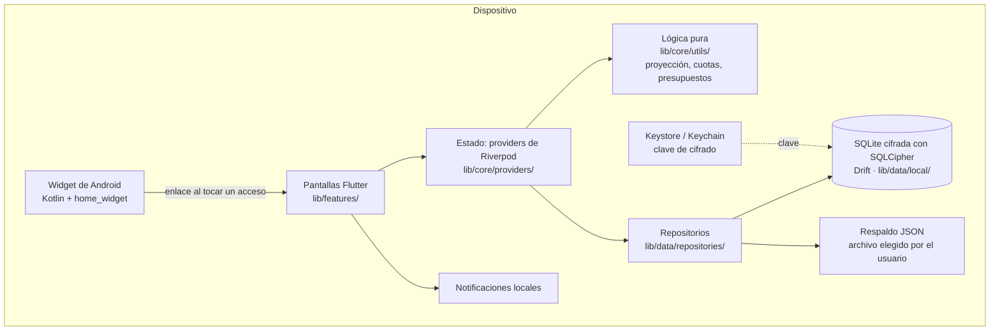

# Peso a Peso

[](https://github.com/maarroyo76/PesoAPeso/actions/workflows/ci.yml)

Aplicación móvil de presupuesto y gastos personales, de registro manual, que
funciona sin conexión y sin vincular cuentas bancarias.

## Descripción

**Qué hace.** Peso a Peso permite registrar cada gasto en pocos toques, fijar
un presupuesto mensual total y por categoría, y ver en qué se va la plata. Su
función principal, "Decidir antes de gastar", proyecta los meses siguientes
con el gasto real del usuario: antes de una compra en cuotas muestra si va a
alcanzar cada mes, la compara con pagar al contado o en otras cuotas, y
permite dejarla en una lista de espera para decidir después.

**A quién va dirigida.** A personas en Chile que hoy controlan sus gastos en
una planilla de Excel o de memoria y buscan algo más práctico para el día a
día, sin entregar sus datos financieros a un banco ni a un servicio en la
nube. Considera el uso habitual de tarjetas de crédito en cuotas, propio del
contexto chileno.

**Qué problema resuelve.** Las apps de finanzas suelen pedir acceso a las
cuentas bancarias o guardar los datos en la nube, y las planillas son lentas
de mantener y no avisan nada. Peso a Peso guarda todo cifrado en el
teléfono, hace el registro tan rápido como anotarlo en un papel y convierte
ese registro en información para decidir: cuánto se puede gastar hoy, qué
compromete una compra en cuotas y qué gastos no valieron la pena.

### Funcionalidades

- Registro manual de gastos, accesos rápidos de un toque (con ×2, ×3) y
  widget de inicio en Android.
- Presupuesto mensual total y por categoría, con alertas al 80% y al 100%, y
  "cuánto puedes gastar hoy".
- Métodos de pago, compras en cuotas con tarjeta de crédito y su estado de
  cuenta estimado.
- Pagos fijos mensuales y gastos habituales con recordatorio y confirmación.
- Metas de ahorro con aportes y uso del ahorro.
- Simulador de compras en cuotas, comparación de alternativas con interés y
  lista de espera.
- Revisión periódica "¿Valió la pena?" de los gastos no esenciales.
- Estadísticas por categoría, por método de pago, costo de vida fijo, gasto
  que no valió la pena y decisiones de la lista de espera.
- Respaldo y restauración en un archivo JSON.

La app no registra ingresos. El prototipo de escaneo de boletas se archivó en
la rama `archivo/escaner-boletas` y no forma parte de la app.

## Tecnologías

| Área | Tecnología |
|---|---|
| Lenguaje y framework | Dart y Flutter (Material 3) |
| Plataformas | Android e iOS (objetivo principal); web y Linux solo para desarrollo y demostración |
| Manejo de estado | Riverpod (`flutter_riverpod`) |
| Base de datos | SQLite local cifrada con SQLCipher (`sqlcipher_flutter_libs`), con Drift como capa de acceso; la clave vive en Keystore/Keychain (`flutter_secure_storage`) |
| Gráficos | fl_chart |
| Notificaciones | `flutter_local_notifications` (alertas de presupuesto y recordatorios de gastos habituales) |
| Widget de Android | `home_widget` y un `AppWidgetProvider` en Kotlin |
| Integración continua | GitHub Actions (`flutter analyze` y `flutter test` en cada push y pull request) |
| Cloud | No usa. Es local-first: los datos financieros no salen del dispositivo |

## Cómo ejecutar el proyecto localmente

Requisitos: Flutter estable (la CI usa la versión 3.44.8) y, para Android, el
SDK de Android o un dispositivo conectado.

1. Clonar el repositorio e instalar las dependencias:
   ```
   git clone https://github.com/maarroyo76/PesoAPeso.git
   cd PesoAPeso
   flutter pub get
   ```
2. Ejecutar la app en el dispositivo o plataforma que prefieras:
   ```
   flutter run              # Android conectado o Linux
   flutter run -d chrome    # Web (solo demostración)
   ```
3. Correr el análisis y las pruebas:
   ```
   flutter analyze
   flutter test
   ```
   Los tests de base de datos usan el SQLite del sistema
   (`libsqlite3.so.0`); en Debian o Ubuntu viene en el paquete
   `libsqlite3-0`.

El código generado de Drift (`app_database.g.dart`) está versionado. Solo hay
que regenerarlo al cambiar el esquema en `app_database.dart`:

```
dart run build_runner build --delete-conflicting-outputs
```

La CI falla si el archivo generado no coincide con el esquema.

### Soporte web (Drift + SQLite WASM)

El proyecto ya incluye `web/sqlite3.wasm` y `web/drift_worker.js`
precompilados para que `flutter run -d chrome` funcione sin pasos extra. Si
se actualiza la versión del paquete `sqlite3` en `pubspec.yaml`, hay que
regenerar ambos archivos (ver comentarios en `lib/data/local/connection_web.dart`
y `lib/data/local/connection_native.dart`).

**Limitación (RNF01):** en web la base usa SQLite WASM **sin cifrar**,
guardada en el almacenamiento del navegador. La versión web sirve para
desarrollo y demostración; los datos reales deben registrarse en Android o
iOS.

## Equipo

| Integrante | Rol |
|---|---|
| Martín Arroyo Quilcat | Desarrollo de la aplicación |
| Carlos Loncuante | Pruebas y diseño |
| Renato Reinoso | Base de datos y documentación |

## Metodología de trabajo

El equipo trabaja con **Kanban**, con el tablero en GitHub Projects. Cada
tarea pasa por las columnas del tablero hasta quedar terminada, sin sprints
de duración fija. El código y la documentación viven en este repositorio:
los cambios se hacen en ramas y entran a `main` mediante pull requests, y
GitHub Actions corre el análisis y las pruebas en cada uno. Las evidencias
del curso están en [`Documentos Capstone/`](Documentos%20Capstone).

## Arquitectura

La app es local-first y está organizada en capas. La interfaz no habla con la
base directamente: lee y escribe a través de providers de Riverpod y de
repositorios, y los cálculos (presupuestos, proyección, cuotas, estadísticas)
son funciones puras separadas de la interfaz, con sus propios tests.



| Capa | Carpeta | Responsabilidad |
|---|---|---|
| Presentación | `lib/features/` | Una carpeta por pantalla: resumen, registro, presupuestos, metas, estadísticas, simulador, lista de espera, revisión, ajustes |
| Estado | `lib/core/providers/` | Providers de Riverpod que exponen los datos de la base como streams |
| Lógica | `lib/core/utils/` | Funciones puras: presupuesto vigente, proyección de meses, cuotas con interés, costo fijo, revisión |
| Datos | `lib/data/` | Esquema Drift y migraciones, repositorios por dominio, respaldo y su validación |
| Plataforma | `lib/core/notifications/`, `lib/core/home_widget/`, `android/` | Notificaciones locales y widget de inicio |

**Seguridad.** En Android e iOS la base se cifra con SQLCipher (ver
`lib/data/local/connection_native.dart`). La clave se genera al primer
arranque (32 bytes de `Random.secure()`) y vive solo en Keystore/Keychain;
si SQLCipher no está disponible, la app se niega a abrir la base en vez de
guardar los datos sin cifrar. Android tiene `allowBackup="false"` para no
respaldar el archivo cifrado sin su clave. Si la base no se puede abrir (por
ejemplo, tras reinstalar la app y perder la clave), la pantalla de error de
arranque permite restaurar un respaldo JSON o empezar de cero.

### Estructura del proyecto

```
lib/
  core/            providers, tema, lógica pura (utils), notificaciones,
                   widget de inicio
  data/
    local/         esquema Drift (app_database.dart) y conexión nativa/web
    repositories/  acceso a datos por dominio
    backup/        exportación y restauración a JSON
  features/        una carpeta por pantalla
test/              tests de lógica, de base de datos y de widgets
android/           proyecto Android, incluido el widget de inicio (Kotlin)
brand/             logo e isotipo en SVG
assets/            fuentes (Crimson Pro, IBM Plex Mono) e ícono de la app
Documentos Capstone/  evidencias del curso por fase
```

## Licencia

MIT (en inglés y español) — ver [LICENSE](LICENSE).
