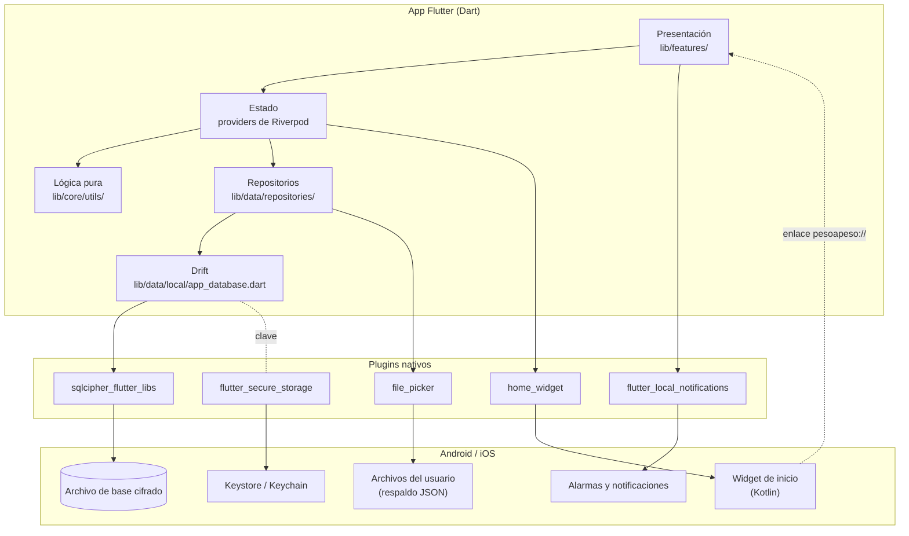
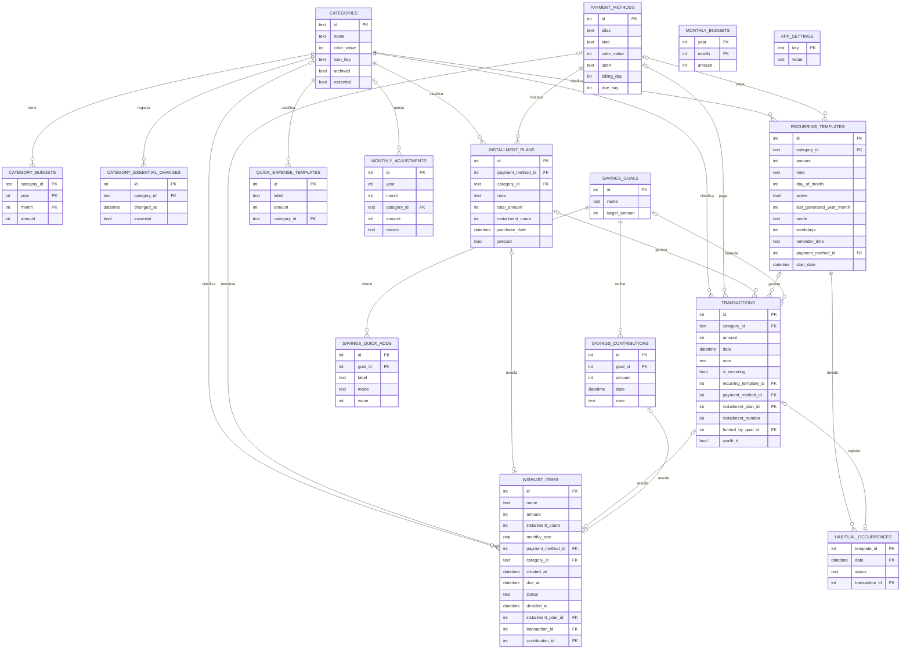
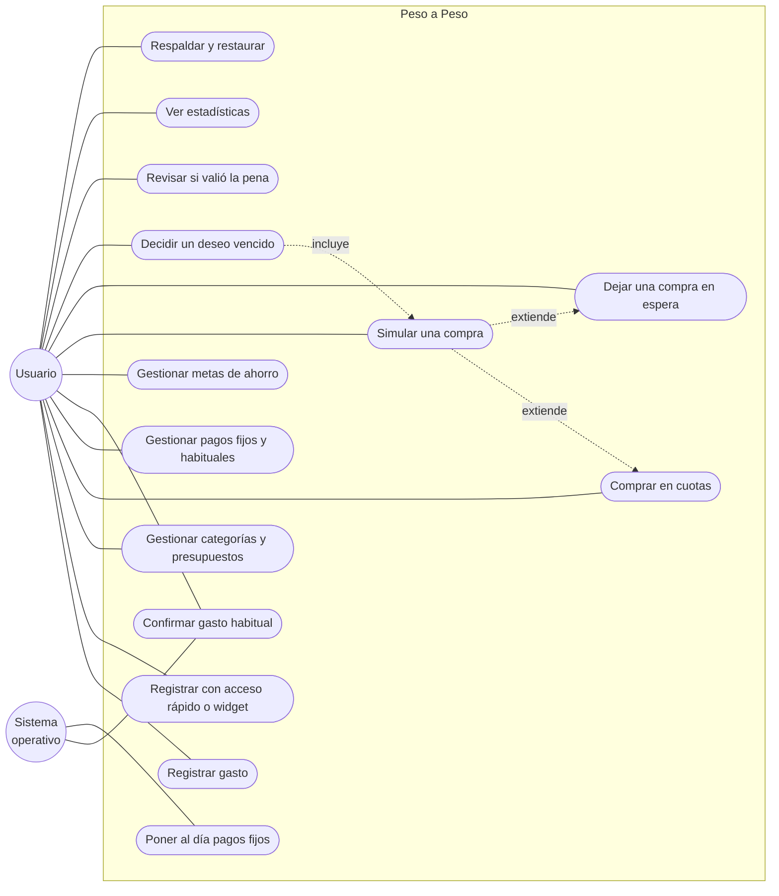
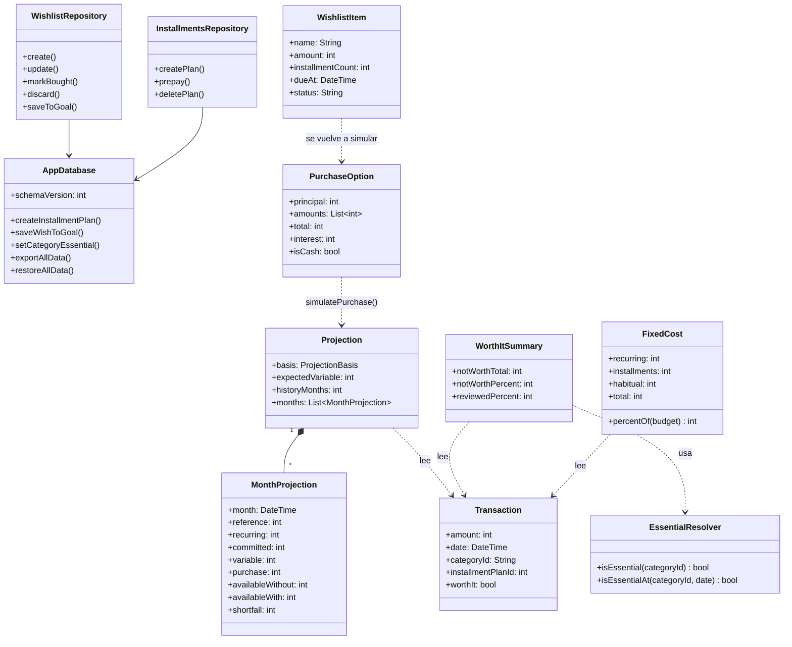
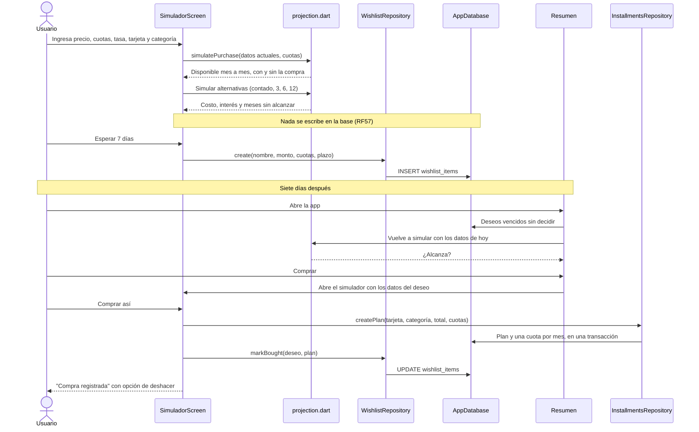
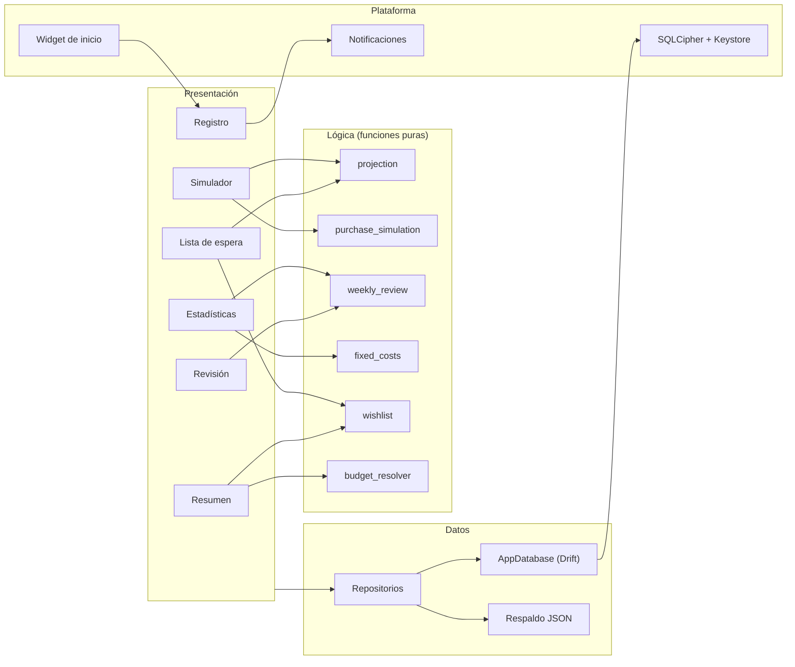

# Documento de diseño: Peso a Peso

Versión del 10 de noviembre de 2026, sobre el código de `main` después del PR
#12 (esquema de base de datos v13, formato de respaldo v4).

## 1. Arquitectura

Peso a Peso es una aplicación móvil **local-first**: todo corre en el
teléfono y no hay servidor. Los datos viven en una base SQLite cifrada en el
dispositivo y la app funciona igual con o sin conexión. Por eso la
arquitectura no tiene servicios remotos que comunicar; la comunicación es
entre las capas de la app y entre la app y el sistema operativo.

La app está organizada en capas. Cada capa solo conoce a la de abajo: las
pantallas no consultan la base directamente, y los cálculos no dependen de la
interfaz.

### 1.1 Componentes

| Componente | Ubicación | Responsabilidad |
|---|---|---|
| Pantallas | `lib/features/` | Una carpeta por pantalla: resumen, registro, presupuestos, metas, estadísticas, simulador, lista de espera, revisión, categorías, métodos de pago, cuotas, recurrentes, respaldo, onboarding y ajustes |
| Providers | `lib/core/providers/app_providers.dart` | Exponen los datos de la base como streams reactivos y combinan datos derivados (presupuesto vigente, si una categoría es esencial) |
| Lógica pura | `lib/core/utils/` | Presupuesto vigente por mes, proyección de meses, cuotas e interés, costo fijo, revisión y estadísticas. Sin acceso a la base ni a la interfaz |
| Repositorios | `lib/data/repositories/` | Un repositorio por dominio (gastos, categorías, cuotas, metas, lista de espera, etc.) que encapsula las consultas |
| Base de datos | `lib/data/local/` | Esquema Drift, migraciones, transacciones y conexión cifrada |
| Respaldo | `lib/data/backup/` | Exportación a JSON, validación antes de restaurar y compatibilidad con versiones anteriores |
| Notificaciones | `lib/core/notifications/` | Alertas de presupuesto y recordatorios de gastos habituales |
| Widget de inicio | `lib/core/home_widget/`, `android/.../QuickAccessWidgetProvider.kt` | Muestra hasta 4 accesos rápidos y abre la app con un enlace |
| Arranque | `lib/main.dart`, `lib/core/startup/` | Abre la base, pone al día los pagos fijos y pregunta por el remanente del mes |

### 1.2 Comunicación entre componentes

No hay servicios en red. La comunicación ocurre dentro del dispositivo:

| Origen | Destino | Mecanismo |
|---|---|---|
| Pantallas | Providers | Riverpod: `ref.watch` para leer, `ref.read` para actuar |
| Providers | Base de datos | Streams de Drift: cada consulta se vuelve a emitir cuando cambian sus tablas, así las pantallas se actualizan solas |
| Repositorios | Base de datos | Consultas y transacciones de Drift; las operaciones que tocan varias tablas (crear un plan de cuotas, ahorrar un deseo) corren en una transacción |
| App | Sistema operativo | Canales de plataforma de cada plugin (clave en Keystore, notificaciones, widget, selector de archivos) |
| Notificación | App | La acción "Registrar" de un gasto habitual corre en segundo plano con su propia conexión; al volver, la app marca las tablas como cambiadas |
| Widget | App | Un `PendingIntent` abre la app con un enlace `pesoapeso://quick?id=N` o `pesoapeso://registrar` |
| App | Widget | La app guarda etiqueta y monto de los accesos rápidos en las preferencias del widget y le pide redibujarse |

### 1.3 Decisiones de diseño

- **Local-first y sin ingresos.** La app no vincula cuentas ni sincroniza, y
  no registra ingresos: la referencia de cada mes es el presupuesto total.
- **Presupuestos versionados.** Cada presupuesto vale desde su mes hasta que
  aparece uno nuevo; cambiarlo no altera los meses pasados. Los ajustes de un
  solo mes van aparte.
- **Cuotas como gastos reales.** Un plan de cuotas genera de una vez un gasto
  por cuota, cada uno en su mes, enlazado al plan.
- **Pagos fijos sin tarea de fondo.** Se ponen al día al abrir la app; solo
  los recordatorios de gastos habituales usan alarmas, y son inexactas.
- **Proyección en funciones puras.** La simulación no escribe nada hasta que
  el usuario confirma y se prueba con datos fijos (RNF24).
- **Cambios de clasificación con fecha.** Marcar una categoría como esencial
  vale desde ese momento; un historial de cambios permite clasificar bien los
  gastos anteriores.

## 2. Modelo de datos

Base SQLite relacional, cifrada con SQLCipher y definida con Drift. Esquema
v13 con 16 tablas. Los montos son enteros en pesos chilenos.

| Tabla | Para qué sirve |
|---|---|
| `categories` | Categorías de gasto; `archived` las oculta sin perder historial y `essential` las saca de la revisión |
| `category_essential_changes` | Cada cambio de "esencial", con su fecha |
| `category_budgets`, `monthly_budgets` | Presupuesto por categoría y total, versionados por mes |
| `monthly_adjustments` | Ajustes que valen un solo mes (remanente sumado al presupuesto) |
| `transactions` | Cada gasto, con su origen: manual, pago fijo, cuota de un plan o pagado con una meta |
| `payment_methods` | Efectivo, débito o crédito; a lo más los últimos 4 dígitos |
| `installment_plans` | Compras en cuotas; sus cuotas son filas de `transactions` |
| `recurring_templates` | Pagos fijos (`mode = auto`) y gastos habituales (`mode = confirm`) |
| `habitual_occurrences` | Decisión sobre cada día de un gasto habitual: registrado u omitido |
| `quick_expense_templates` | Accesos rápidos |
| `savings_goals`, `savings_contributions`, `savings_quick_adds` | Metas, aportes y accesos rápidos de aporte |
| `wishlist_items` | Lista de espera: deseo, plazo, estado y lo que resultó de la decisión |
| `app_settings` | Preferencias y marcas de una vez por mes (clave y valor) |

**Integridad.** Las claves foráneas están activas en cada conexión. Las
relaciones opcionales de la lista de espera usan `ON DELETE SET NULL`, para
que borrar una tarjeta, un plan o un aporte no lo impida un deseo. El
historial de "esencial" se borra en cascada con su categoría.

**Migraciones.** Cada cambio de esquema sube `schemaVersion` y agrega un paso
en `onUpgrade`. Hay tests de las migraciones v1 → v2, v7 → v8, v9 → v10,
v11 → v12 y v12 → v13.

## 3. Diagramas UML

### 3.1 Casos de uso

### 3.2 Clases

Clases principales de la lógica de "Decidir antes de gastar" y de los datos
que usa. Las clases de datos (`Transaction`, `WishlistItem`, etc.) las genera
Drift desde el esquema.

### 3.3 Secuencia de la funcionalidad principal

Simular una compra, dejarla en espera y comprarla al vencer el plazo.

### 3.4 Componentes

## 4. Requisitos no funcionales

| ID | Categoría | Requisito | Estado y evidencia |
|---|---|---|---|
| RNF01 | Seguridad | Los datos financieros no salen del dispositivo | Cumple: el APK de release no pide `INTERNET` (verificado con `aapt2 dump permissions`). Pide `WAKE_LOCK`, `ACCESS_NETWORK_STATE` y `FOREGROUND_SERVICE`, que agrega WorkManager desde `home_widget`; ninguno permite enviar datos |
| RNF02 | Seguridad | Datos aislados de otras apps | Cumple: sandbox de la app más base cifrada |
| RNF03 | Seguridad | Protección contra inyección SQL | Cumple: Drift usa consultas parametrizadas |
| RNF04 | Seguridad | El usuario controla sus respaldos | Cumple: el respaldo es un archivo que el usuario guarda; la app advierte que no está cifrado |
| RNF05 | Privacidad | Términos y condiciones con asesoría legal | Fuera del código |
| RNF06 | Rendimiento | Registrar y ver el resumen en menos de 1 s | Sin medición en dispositivo |
| RNF07 | Rendimiento | Abrir en menos de 3 s con pagos fijos pendientes | Parcial: el catch-up usa una transacción por pago; sin medición en dispositivo |
| RNF08 | Rendimiento | Estadísticas fluidas con historial extenso | Cumple en el computador de pruebas: 6 meses de estadísticas sobre 24 meses de historial en 1 ms (`performance_test.dart`); falta medir en dispositivo |
| RNF09 | Disponibilidad | Todo funciona sin conexión | Cumple |
| RNF10 | Disponibilidad | Los pagos fijos se ponen al día aunque la app no se abra por días | Cumple (catch-up al abrir) |
| RNF11 | Confiabilidad | Sin pérdida de datos ante un cierre inesperado | Cumple: escrituras compuestas en transacciones; pantalla de error de arranque con salida |
| RNF12 | Escalabilidad | El historial crece sin degradar la experiencia | Cumple en el computador de pruebas: consultar un mes en una base de 24 meses toma 1 ms |
| RNF13 | Escalabilidad | Evolución a versión web con cuenta | Futuro, solo diseño |
| RNF14 | Portabilidad | Android e iOS desde un único código | Cumple (Flutter); iOS sin probar en dispositivo |
| RNF15 | Usabilidad | Registrar un gasto en pocos pasos | Cumple: un toque con acceso rápido o widget |
| RNF16 | Privacidad | Solo alias y hasta 4 dígitos de una tarjeta | Cumple, también validado por un `CHECK` en la base |
| RNF18 | Confiabilidad | La migración a v10 conserva los gastos | Cumple (test de migración) |
| RNF19 | Compatibilidad | El respaldo acepta versiones anteriores | Cumple: formato v4, acepta v1 a v3 |
| RNF20 | Compatibilidad | Recordatorios sin `SCHEDULE_EXACT_ALARM` | Cumple |
| RNF21 | Seguridad | Cifrado en reposo; sin cifrado, la app no abre la base | Cumple (SQLCipher, clave en Keystore/Keychain) |
| RNF22 | Accesibilidad | Contraste AA, letra grande y lector de pantalla | Cumple en las 6 pantallas principales: tests automáticos de contraste AA, etiquetas y área táctil en tema claro y oscuro, y de letra al 200%. El simulador y la lista de espera todavía no están en esos tests |
| RNF23 | Rendimiento | La simulación en menos de 500 ms con 24 meses | Cumple en el computador de pruebas: 110 ms para la compra y sus 5 alternativas |
| RNF24 | Confiabilidad | Proyección en funciones puras con tests de datos fijos | Cumple (`projection_test.dart`) |

**Portabilidad y Docker.** La portabilidad se resuelve con Flutter: un mismo
código compila para Android e iOS. El proyecto no usa Docker, porque la app
no tiene backend ni servicios que desplegar: corre entera en el teléfono, y
un contenedor no puede ejecutar una app móvil. La justificación completa
está en el manual técnico (`04_Manual_Tecnico.md`, sección 7).

## 5. Innovación

### ¿Qué problema resuelve?

Quien controla sus gastos en una planilla o en una app de registro sabe lo
que ya gastó, pero no lo que ya comprometió. En Chile, donde comprar en
cuotas con tarjetas bancarias y de retail es parte del día a día, cada compra
en cuotas carga meses que todavía no llegan: una persona puede tener el mes
en curso bajo control y, sin notarlo, dejar los tres siguientes sin margen.

Las herramientas disponibles no responden a la pregunta que importa antes de
comprar: *¿me alcanza, no solo este mes, sino los próximos?* Las apps que
podrían calcularlo piden vincular la cuenta bancaria o subir los datos a la
nube, algo que muchas personas no están dispuestas a hacer con su información
financiera.

### ¿Qué hace diferente a la solución?

**Mira hacia adelante, no solo hacia atrás.** Peso a Peso proyecta el
disponible de cada mes futuro con los datos reales del usuario: su
presupuesto, sus pagos fijos, las cuotas que ya tiene y su gasto variable
típico, calculado como la mediana de sus últimos tres meses para que un mes
atípico no distorsione la proyección. Sobre esa proyección, una compra se
simula antes de hacerla.

**Compara formas de pago con números del usuario.** El simulador muestra la
misma compra al contado y en 3, 6 y 12 cuotas, con el interés real cuando lo
hay, y dice en cuántos meses no alcanzaría cada opción. No es una calculadora
de cuotas genérica: el resultado depende del presupuesto y los compromisos de
esa persona.

**Convierte la espera en una herramienta.** Una compra no urgente se puede
dejar en espera 48 horas, 7 o 30 días. Al vencer el plazo, la app vuelve a
simularla con los datos de ese día y pregunta si todavía se quiere: comprar,
descartar o llevar ese monto a una meta de ahorro.

**Aprende de lo que no valió la pena.** La revisión periódica pregunta solo
por los gastos no esenciales. Ese dato vuelve al momento de decidir: al
simular una compra, la app muestra qué tan seguido los gastos de esa
categoría no valieron la pena.

**Todo sin entregar los datos.** El análisis ocurre en el teléfono, con la
base cifrada y sin conexión. No hay vinculación bancaria ni nube, y aun así
el registro es rápido: un toque con un acceso rápido o desde el widget de la
pantalla de inicio.

### ¿Qué valor agrega?

| Para | Valor |
|---|---|
| El usuario | Decide una compra en cuotas sabiendo cómo quedan sus próximos meses, antes de comprometerse |
| El usuario | Tiene un espacio para no comprar por impulso, y ve cuánto dejó de gastar gracias a esa pausa |
| El usuario | Conoce su costo de vida fijo: cuánto de su presupuesto ya está comprometido cada mes |
| El usuario | Mantiene el control de sus datos financieros: nada sale de su teléfono |
| El usuario | Registra en un toque, lo que hace sostenible el hábito |

El valor está en unir dos cosas que hoy van por separado: el registro manual,
que respeta la privacidad pero solo describe el pasado, y la planificación
financiera, que suele exigir entregar los datos. Peso a Peso usa el registro
que el usuario ya hace para ayudarlo a decidir, en su teléfono y con su
contexto.
